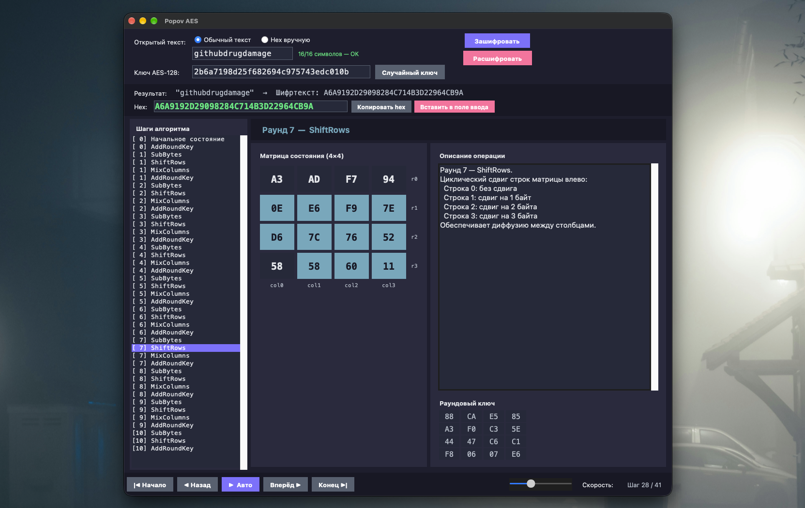

# AES Visualizer

A Python and Tkinter app for stepping through AES-128 encryption and decryption, with a state matrix and round keys at each step.



## Run

Requires Python 3 with Tkinter.

```sh
python3 aes.py
```
